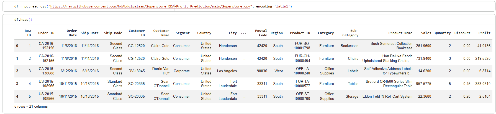
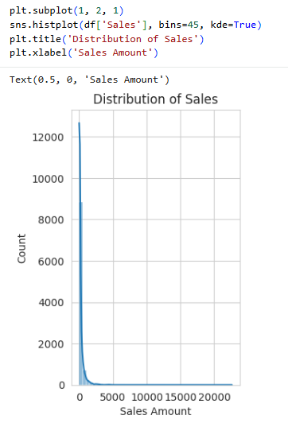
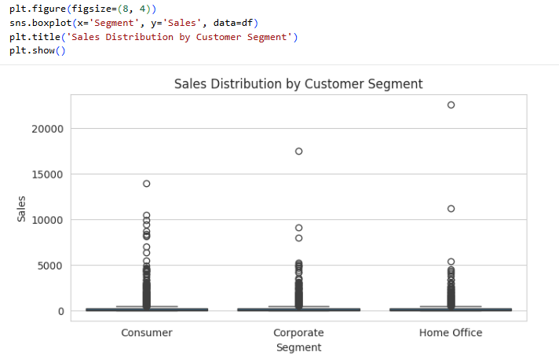
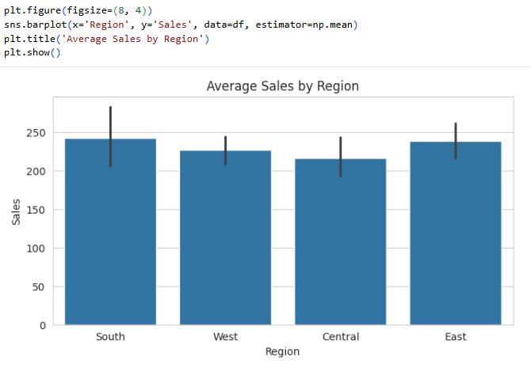
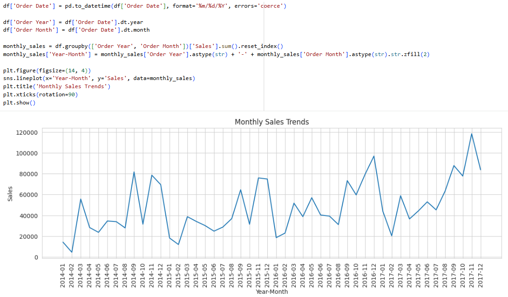
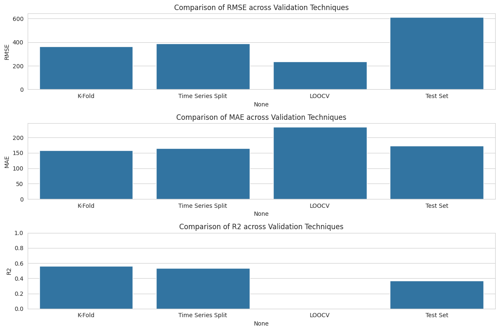
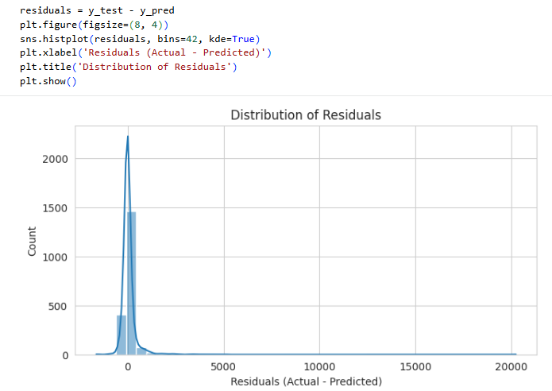

# Retail Sales Analysis & Predictive Modeling

### Exploratory Data Analysis | Python | Machine Learning

A data analytics project exploring retail transaction data to uncover business insights and develop a predictive model for sales estimation.

---

## Project Overview

This project analyses approximately 10,000 retail transactions using Python. It combines exploratory data analysis, data preprocessing, feature engineering, and machine learning to investigate sales patterns and evaluate the predictive performance of a K-Nearest Neighbors (KNN) regression model.

## Business Objectives

- Identify sales patterns across products, regions, and customer segments.
- Examine the distribution and behaviour of retail sales.
- Explore temporal trends and seasonal fluctuations.
- Develop a regression model to predict sales.
- Evaluate model performance using multiple validation techniques.

## Tools & Technologies

- **Programming:** Python
- **Data Manipulation:** Pandas, NumPy
- **Data Visualization:** Matplotlib, Seaborn
- **Machine Learning:** Scikit-learn
- **Environment:** Google Colab

## Project Workflow

| Stage | Activities |
|---|---|
| Data Exploration | Dataset structure, data types, missing values, descriptive statistics |
| Exploratory Analysis | Sales distributions, category and regional analysis, customer segments, trends |
| Data Preparation | Feature selection, categorical encoding, feature scaling |
| Predictive Modeling | K-Nearest Neighbors (KNN) Regression |
| Model Evaluation | K-Fold, Time Series Split, LOOCV and independent test evaluation |

## Key Business Insights

The exploratory analysis identified several notable patterns:

- Sales exhibited a positively skewed distribution.
- Technology recorded the highest total sales among product categories.
- The West region had the highest average sales.
- Consumer customers represented the largest share of sales.
- Standard Class was the most frequently used shipping method.
- Sales activity displayed temporal and seasonal fluctuations.

## Model Evaluation

A KNN regression model was developed using five nearest neighbours.

Model performance was examined using:

- Root Mean Squared Error (RMSE)
- Mean Absolute Error (MAE)
- Coefficient of Determination (R²)

Multiple validation approaches were used to examine predictive performance under different evaluation settings.

---

## Project Visualizations

### 1. Dataset Overview

Initial exploration of the retail transaction dataset, including its structure and sample observations.

### 2. Sales Distribution

Visual analysis of the distribution of sales across retail transactions.

### 3. Sales Insights

Exploration of sales performance across product categories and geographic regions.

### 4. Model Evaluation

Evaluation of the KNN regression model using the selected validation approaches.

### 5. Prediction Analysis

Visual assessment of the relationship between actual and predicted sales.

---

## Repository Contents

| File | Description |
|---|---|
| `Retail_Sales_Analysis.ipynb` | Complete Python analysis and modelling notebook |
| `Superstore.csv` | Retail transaction dataset |
| `Retail_Sales_Analysis_Documentation.pdf` | Project documentation and methodology |

## How to Run

1. Open the Jupyter Notebook in Google Colab or Jupyter.
2. Download the dataset from this repository.
3. Ensure the required Python libraries are installed.
4. Run the notebook cells sequentially.
5. Review the analysis, visualizations, and model evaluation.

## Limitations & Future Scope

Potential extensions include:

- Comparing KNN with Random Forest and Gradient Boosting.
- Conducting systematic hyperparameter optimization.
- Investigating the effect of outliers and sales skewness.
- Strengthening chronological validation.
- Reviewing feature selection to prevent target leakage.

## Dataset Source

[Superstore Dataset](https://raw.githubusercontent.com/NdAbdulsalaam/Superstore_EDA-Profit_Prediction/main/Superstore.csv)

## Author

**Sarah Abdul Hameed**

Business Analytics | Economics | Data Analysis | Predictive Modeling
